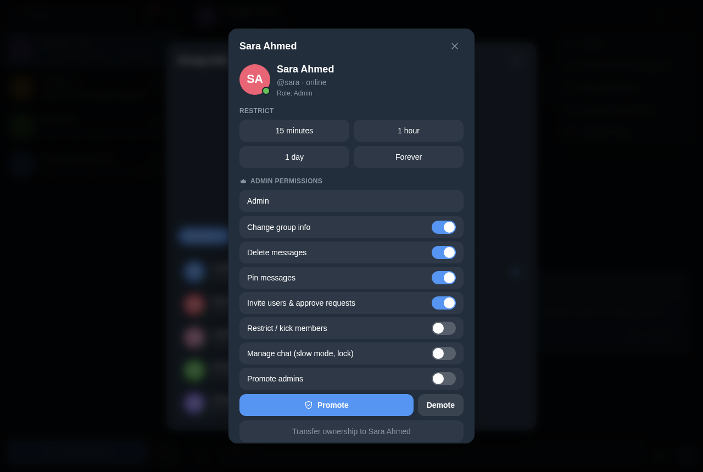

# تعافي من الإدمان — Telegram-Style Group Chat

> ئەپی چاتی گرووپی — وەک تێلێگرام — بۆ کۆمەڵگەی ڕێکخستنەوە. RTL، عەرەبی + کوردی، خێرا و خەسڵەتدار.
> A privacy-first, recovery-themed group chat with a Telegram-like Arabic/Kurdish UX, full RTL support, and a real-time sync engine.

<div align="center">
  
</div>

## Features

- **Master owner account** — a single immutable identity (`یوسف الکردي` / `master_owner_yousif`). Every spelling variant of the name (ي/ی، ك/ک) folds to the same account, so duplicate-owner and "two accounts for one person" bugs cannot happen (see `profileStore.ts`).
- **Realtime sync** — messages, groups, typing indicators and invitations stay in sync between desktop and phone across restarts, via `src/lib/realtime.ts` (Poll + Flush engine, per-chat revision merging, tombstones for deleted groups).
- **Typing pill** — "يكتب الآن…" in the header, above the composer in groups/DMs, TTL-protected.
- **Roles & badges** — owner / admin / member with custom titles; the badge never clips the header title.
- **Moderation** — kick, mute, per-admin permissions, join requests, invitations — all with confirmation modals.
- **Official community group** — `مجتمع لا أبرح حتى أبلغ` is seeded on every fresh install (`src/data/seed.ts`).
- **Group info modal** — deduplicated member list, live member count, group settings with permission gating.
- **Emoji picker** — 6-column grid, Arabic/English keyword search, strictly non-human, non-religious, non-crude emoji set.
- **Boot recovery UI** — if a code chunk fails to load (stale deploy), a friendly recovery screen offers reload/reset instead of a white page.
- **i18n** — Arabic + English dictionaries, RTL everywhere, dark/light themes, font-size zoom, mobile layout.

## Stack

React 18 · TypeScript · Vite · Tailwind CSS v4 · Zustand (persist) · Node 22 · Vercel + GitHub Contents API

```
telegram-group-chat/
├── src/                        # app code
│   ├── components/             # ChatHeader, Composer, MessageList, MessageBubble, GroupInfoModal, EmojiPicker, …
│   ├── store/                  # chatStore.ts (persist v6) · profileStore.ts (persist v4, master-owner identity)
│   ├── lib/realtime.ts         # realtime client engine — GET/POST {endpoint}/state
│   ├── i18n.ts                 # ar + en dictionaries
│   └── data/seed.ts            # official community group seed
├── server/realtime-node.mjs    # self-hostable realtime server (dev & prod-lite)
├── api/state.mjs               # Vercel serverless function → GitHub-backed state store
├── v*-test.mjs / testkit.mjs   # Playwright suites + shared fixtures
├── vercel.json                 # no-store headers (+ immutable assets)
└── index.html                  # boot screen + recovery UI
```

## Quick start

```bash
npm install
npm run dev
```

### Self-hosting the realtime server (optional)

```bash
npm run build
node server/realtime-node.mjs
# listens on port 4173 — serves dist/ + /api/state
# persists to server-data/state.json (start empty with RT_WIPE=1)
```

Point the dev app at your server:

```bash
echo "VITE_REALTIME_URL=http://localhost:4173/api" > .env.local
npm run dev
```

### API

| Route | Description |
| ----- | ----------- |
| `GET /api/state` | the full live snapshot (users, chats, invitations, typing) |
| `POST /api/state` | authoritative flush of the client's whole state (client-authoritative merge) |
| `POST /api/reset` | wipe live state (Node server, dev/tests) |
| `POST /api/state?reset=1` | wipe the persisted state (Vercel function) |

### Snapshot protocol

```jsonc
// GET {endpoint}/state
{
  "tag": "tgc-live-v1",
  "rev": 1792380400000,          // server-owned monotonic revision
  "savedAt": 1792380090190,
  "users": { "master_owner_yousif": { "id": "…", "name": "یوسف الکردي" } },
  "chats":  [ { "id": "c9", "rev": 1792380371, "memberIds": ["…", "u_m"], "messages": [] } ],
  "invitations": [],
  "typing": [ { "chatId": "c9", "userId": "u_m", "name": "سامر", "at": 1792380399 } ]
}
```

Rules:

- **Per-chat LWW** — each chat carries its own `rev`; the higher revision wins (server and client both apply the same rule).
- **Tombstones** — deleted/left groups keep a `deletedAt` marker and are never resurrected.
- **Typing TTL** — typing entries live 2600 ms and are pruned server-side.
- **Message cap** — each chat keeps at most 600 messages on the wire.
- **Fingerprint polling** — the client sends `x-tgc-fp` (an ASCII sha1 digest of the snapshot — HTTP headers must be ASCII) and the server answers {"same":true} when nothing changed, saving bandwidth.

The client keeps typing entries out of localStorage (ephemeral), and stores no chat history beyond the merged snapshot — the server is the only shared source of truth.

## Deployment (Vercel + GitHub-backed state)

1. Push this repo to GitHub, then **Import Project** in Vercel.
2. Create a private "state" repo for the persisted snapshot (example: `Yusfkarim/tgc-state`):

```bash
gh repo create tgc-state --private --disable-wiki --disable-issues
gh api -X PUT /repos/Yusfkarim/tgc-state/contents/state.json \
  -f message="initial empty state" \
  -f content="$(printf '{"tag":"tgc-live-v1","rev":0,"savedAt":0,"users":{},"chats":[],"invitations":[],"typing":[]}' | base64 -w0)"
```

3. Add a GitHub token (with contents read/write on that repo) to Vercel:

```bash
npx vercel env add GH_TOKEN production
```

4. Deploy:

```bash
npx vercel --prod --yes --token <VERCEL_TOKEN>
```

Notes:

- The Vercel function must **await** the GitHub write before responding — serverless functions freeze right after the response, killing any pending work (`api/state.mjs` handles this).
- GitHub contents API supports ETag revalidation; the function caches the blob in memory and the client's `x-tgc-fp` round-trip keeps polling cheap.
- `GH_TOKEN` and `TGC_STATE_REPO` are the only environment variables the realtime endpoint needs.

## Testing

```bash
node boot-test.mjs        # boot + blocked-asset recovery screen
node owner-test.mjs       # 23 checks — master-owner identity, single rename, ownership persistence
node v6-test.mjs          # 92 checks — state purge, moderation, zero-perm admins, fonts, session
node v7-test.mjs          # 55 checks — online dot, menus, swipe-to-reply, mentions, settings flows
node fix-test.mjs         # 11 checks — private group list, DM from bubble, sends
node locked-test.mjs      # 8  checks — locked mode & composer gating
node browser-test.mjs     # 17 checks — panes & emoji grid rendering
node mobile-test.mjs      # 8  checks — mobile layout at 390×844
node v9-test.mjs          # 10 checks — six-point acceptance suite
node stress.mjs           # robustness against weird inputs (names, big state, guests)
```

- `resetLive()` in `testkit.mjs` resets the live server before every boot so independent test worlds never contaminate each other.
- Install Playwright browsers first: `npx playwright install`.
- The six-point acceptance suite (`v9-test.mjs`) covers the production checklist: master identity, badge unclipping, member dedupe, sender labels, typing broadcast, and the emoji picker.

## Identity & auth notes

- The master owner is `یوسف الکردي` (`master_owner_yousif`), promoted through an owner-login gate.
- The owner-login password (`12345678rk`) lives **client-side** and is demo-level; for real deployments replace it with a backend check.
- No tokens or secrets are committed — the production `GH_TOKEN` lives only in Vercel's environment variables.

## Deployed instance

**https://telegram-group-chat.vercel.app** — realtime state persisted to `Yusfkarim/tgc-state`.

## License

MIT
